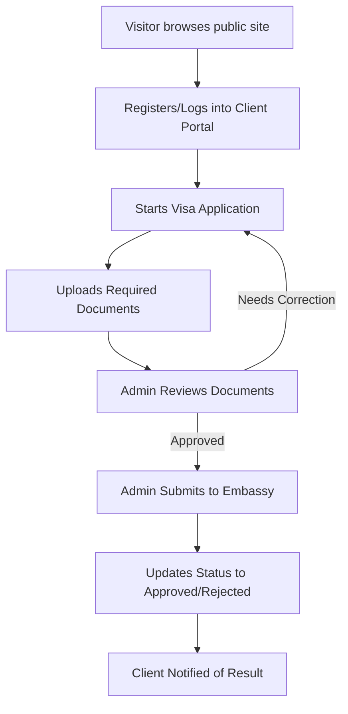

## 1. Product Overview
A comprehensive full-stack platform for a visa assistance agency based in Berkane, Morocco. 
It facilitates the process of obtaining visas for European countries and Canada by providing a public-facing website, a secure client portal for document management and tracking, and a powerful admin dashboard for agency staff. The platform is fully localized in English, French, Spanish, and Arabic to cater to a diverse clientele.

## 2. Core Features

### 2.1 User Roles
| Role | Registration Method | Core Permissions |
|------|---------------------|------------------|
| Client | Self-registration (Email) | Apply for visas, upload documents, track application status, communicate with agency, make payments |
| Admin / Agent | Created by Super Admin | Manage client applications, verify documents, update application statuses, communicate with clients |
| Super Admin | System initialization | Manage staff, view analytics, configure platform settings, manage visa types and requirements |

### 2.2 Feature Modules
1. **Public Website**: Hero section, Services (European & Canada Visas), About Us (Berkane, Morocco), Contact, Language Switcher (EN, FR, ES, AR).
2. **Client Portal**: Dashboard, Application Wizard, Document Vault, Status Tracker, Messaging/Notifications.
3. **Admin Dashboard**: Analytics Overview, CRM (Client List), Application Pipeline (Kanban), Document Review, User Management.

### 2.3 Page Details
| Page Name | Module Name | Feature description |
|-----------|-------------|---------------------|
| Home Page (Public) | Hero & Services | High-conversion landing page outlining visa services and agency credibility. |
| Client Dashboard | Overview | Summary of active applications, required actions, and recent notifications. |
| Application Wizard | Form & Uploads | Step-by-step visa application process with document upload capabilities. |
| Admin Pipeline | Kanban Board | Drag-and-drop interface for staff to move applications through stages (e.g., Review, Submitted, Approved). |

## 3. Core Process
Clients browse the public site, register an account, and start a visa application. They upload required documents based on the selected visa type. Admins review the documents, request changes if necessary, and process the application, updating the status. Clients are notified at each step.

## 4. User Interface Design

### 4.1 Design Style
- **Primary Colors**: Professional Navy Blue and Gold (conveying trust, premium service, and international travel).
- **Button Style**: Slightly rounded, solid colors for primary actions, subtle shadows for depth.
- **Typography**: Clean, modern sans-serif fonts (e.g., Inter for EN/FR/ES, and a legible Naskh-style font for Arabic like Cairo or Tajawal).
- **Layout Style**: Modern card-based layouts for dashboards; expansive, clean sections for the public site.
- **RTL Support**: Full Right-to-Left (RTL) layout support when Arabic is selected.

### 4.2 Page Design Overview
| Page Name | Module Name | UI Elements |
|-----------|-------------|-------------|
| Public Site | Navigation | Sticky header, language selector dropdown, clear "Apply Now" CTA. |
| Client Portal | Document Upload | Drag-and-drop zones, progress bars, clear status badges (Pending, Verified). |
| Admin Dashboard | Pipeline | Interactive Kanban columns, client avatars, quick-action menus on cards. |

### 4.3 Responsiveness
Desktop-first approach for complex admin interfaces, but fully mobile-adaptive. The public site and client portal must be highly optimized for mobile touch interactions, as many clients will upload documents via smartphone.
