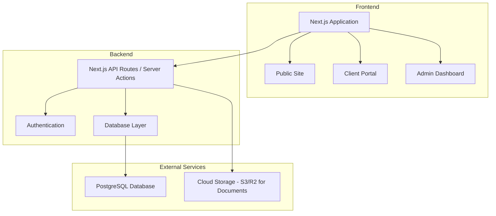
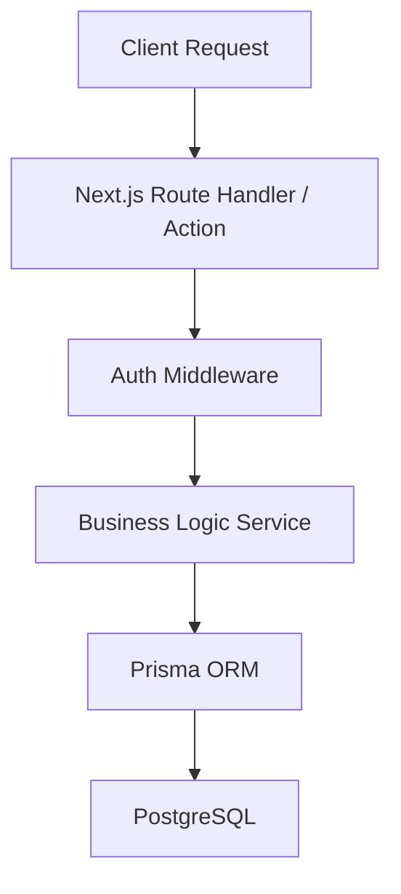
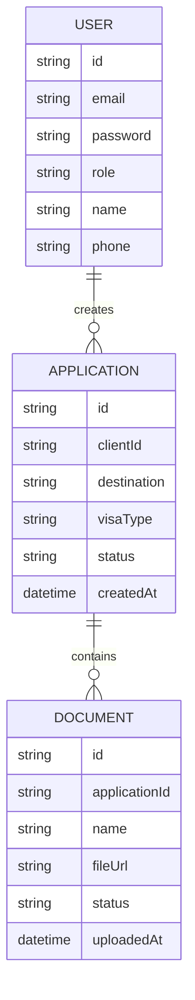

## 1. Architecture Design


## 2. Technology Description
- **Frontend**: Next.js 14 (App Router) + React@18 + tailwindcss@3 + shadcn/ui
- **State & Data Fetching**: React Query / SWR or Next.js Server Actions
- **Internationalization (i18n)**: next-intl for EN, FR, ES, AR (with RTL support)
- **Backend**: Next.js Server Actions / API Routes (Node.js runtime)
- **Database**: PostgreSQL (via Prisma ORM or Drizzle)
- **Authentication**: NextAuth.js (Auth.js)
- **Storage**: AWS S3 or Cloudflare R2 for secure document storage

## 3. Route Definitions
| Route | Purpose |
|-------|---------|
| `/` | Public Home Page |
| `/services` | Visa Services (European, Canada) |
| `/contact` | Contact Information for Berkane Agency |
| `/portal` | Client Portal Dashboard |
| `/portal/applications` | Client's Visa Applications |
| `/portal/documents` | Client's Uploaded Documents |
| `/admin` | Admin Dashboard Overview |
| `/admin/clients` | CRM / Client Management |
| `/admin/pipeline` | Application Kanban Board |

## 4. API Definitions
```typescript
interface User {
  id: string;
  email: string;
  role: 'CLIENT' | 'ADMIN' | 'SUPER_ADMIN';
  name: string;
  phone?: string;
}

interface Application {
  id: string;
  clientId: string;
  destination: 'EUROPE' | 'CANADA';
  visaType: 'TOURIST' | 'STUDENT' | 'WORK';
  status: 'DRAFT' | 'SUBMITTED' | 'IN_REVIEW' | 'ACTION_REQUIRED' | 'APPROVED' | 'REJECTED';
  createdAt: Date;
  updatedAt: Date;
}

interface Document {
  id: string;
  applicationId: string;
  name: string;
  type: string;
  url: string;
  status: 'PENDING' | 'VERIFIED' | 'REJECTED';
}
```

## 5. Server Architecture Diagram


## 6. Data Model
### 6.1 Data Model Definition


### 6.2 Data Definition Language
```sql
CREATE TABLE "User" (
    "id" TEXT NOT NULL,
    "email" TEXT NOT NULL,
    "password" TEXT NOT NULL,
    "role" TEXT NOT NULL DEFAULT 'CLIENT',
    "name" TEXT,
    "phone" TEXT,
    "createdAt" TIMESTAMP(3) NOT NULL DEFAULT CURRENT_TIMESTAMP,
    CONSTRAINT "User_pkey" PRIMARY KEY ("id")
);

CREATE UNIQUE INDEX "User_email_key" ON "User"("email");

CREATE TABLE "Application" (
    "id" TEXT NOT NULL,
    "clientId" TEXT NOT NULL,
    "destination" TEXT NOT NULL,
    "visaType" TEXT NOT NULL,
    "status" TEXT NOT NULL DEFAULT 'DRAFT',
    "createdAt" TIMESTAMP(3) NOT NULL DEFAULT CURRENT_TIMESTAMP,
    "updatedAt" TIMESTAMP(3) NOT NULL,
    CONSTRAINT "Application_pkey" PRIMARY KEY ("id")
);

ALTER TABLE "Application" ADD CONSTRAINT "Application_clientId_fkey" FOREIGN KEY ("clientId") REFERENCES "User"("id") ON DELETE RESTRICT ON UPDATE CASCADE;

CREATE TABLE "Document" (
    "id" TEXT NOT NULL,
    "applicationId" TEXT NOT NULL,
    "name" TEXT NOT NULL,
    "fileUrl" TEXT NOT NULL,
    "status" TEXT NOT NULL DEFAULT 'PENDING',
    "uploadedAt" TIMESTAMP(3) NOT NULL DEFAULT CURRENT_TIMESTAMP,
    CONSTRAINT "Document_pkey" PRIMARY KEY ("id")
);

ALTER TABLE "Document" ADD CONSTRAINT "Document_applicationId_fkey" FOREIGN KEY ("applicationId") REFERENCES "Application"("id") ON DELETE RESTRICT ON UPDATE CASCADE;
```
