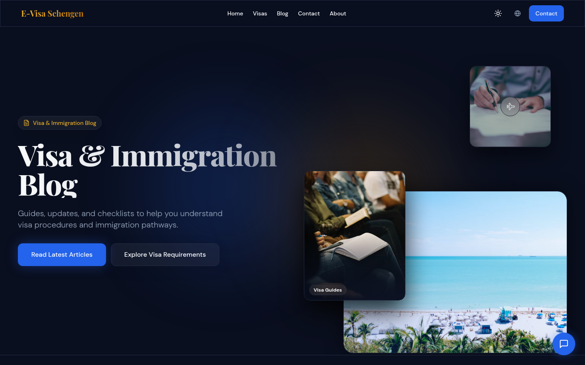

# Berkanevisaplus

Website for a Schengen visa assistance service in Berkane, Morocco. A React single page app with an API running on a Cloudflare Worker and a D1 database.



## Features
- Pages: home, visas, blog, about, contact, login and register
- Client portal and admin area, with role based access
- Languages: English, French, Spanish, Arabic (RTL)
- A keyword based help chatbot (rules, not AI)

## Stack
React, Vite, TypeScript, Hono API on Cloudflare Workers, Cloudflare D1.

## Setup
```bash
npm install
cp .env.example .env   # fill in your own values
npm run dev
```

Required secrets (never commit them): `JWT_SECRET` (long random string), `ADMIN_BOOTSTRAP_TOKEN` (16+ random characters; the first admin registers by sending it as `adminToken`, and only while no admin exists). Optional: `LEGACY_PASSWORD_SALT` to upgrade old password hashes on login.

Set them on the Worker with `wrangler secret put JWT_SECRET`.

## Tests
```bash
npm run check   # type check
npm run build
```
The password module has a test in `api/lib` (run with `npx tsx` on the test file).

## Security notes
Passwords are hashed with PBKDF2. No one becomes admin from an email address alone or by registering first. Do not commit `.env` or database files.

## License
The source code is licensed under the MIT License (see [LICENSE](LICENSE)). The licence covers the code only. Photos and other images (including images from Unsplash), brand names, logos and business text (for example restaurant or visa-agency details) are not covered: they keep their own terms or are reserved by their owners.
